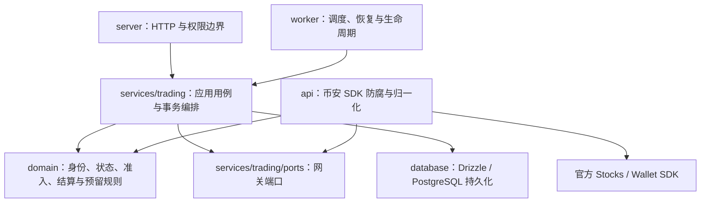

# 领域设计与交易执行边界

- 类型：架构说明、开发指导。
- 状态：现状参考，持续维护。
- 影响范围：现行后端领域架构；领域结构始于0.6.0，0.6.1仅补健康端点跨源读取，未改当时的领域或业务公开契约。
- 前置：[产品事实](../../PRODUCT.md)、[架构现状](implementation-plan.md)、[领域重构历史记录](../changes/0013-startup-domain-stocks-errors.md)。

## 结论与理由

原项目有领域服务的基础，但不是清晰独立领域层的 DDD：交易用例已按任务、订单、预留、结算和行情分组，存在可注入的网关及无 I/O 策略；然而纯规则引用公开 Zod 契约、HTTP 错误和数据库推导类型，领域概念与应用编排的边界不够明确。

当前采用**轻量 DDD 的模块化单体**，不是套用完整企业模板。订单意图、未知结果、成交去重、占用守恒、最终费用和执行窗口有足够复杂度，值得用独立领域模型表达；用户管理、配置、审计查询等简单 CRUD 不为模式增加聚合、仓储或领域事件。

|选择|本项目理由|
|---|---|
|独立金融领域核心|同一规则同时服务 HTTP、Worker、恢复和核对；不能在各入口重写确定性、费用或终态判断|
|函数型丰富领域模型|已有计算和状态转换可以纯函数表达；输入为最小业务投影，输出结算或状态计划，不必创建额外实体包装和对象副本|
|保留具体 SQL 事务|账户锁、订单锁、任务锁和流水必须在真实事务中协调；泛型仓储包装不能替代这些一致性要求|
|网关端口与币安防腐层|SDK 的状态、错误、回执和费用要先转换成平台业务含义，不能直接决定本地订单完成或资产可用|
|不引入 CQRS、事件溯源或分布式服务|当前没有独立读写存储、跨服务事务或多种持久化实现的需求；增加组件会扩大故障与恢复面|

## 依赖方向

领域层只依赖自身模块、`decimal.js` 和用于确定性指纹／批次种子的 `node:crypto`；不导入 SDK、Hono、Drizzle、配置、公开 Zod DTO 或持久化行类型。

应用层仍直接组织具体 SQL、事务和适配器组装。这是保留精确一致性边界的有意选择，不能将其描述为“所有基础设施都已由仓储接口隔离”的完整企业 DDD。

## 领域模块与统一语言

|模块|职责与真实代码|
|---|---|
|`domain/shared/domain-error.ts`|领域拒绝只包含 `code/message`，不携带 HTTP 状态、SQL 或 SDK 请求|
|`domain/shared/decimal.ts`|精确十进制及金额／数量序列化；50 位运算精度，金额18位、数量10位小数，不经 JS 浮点累计|
|`domain/orders/identity.ts`|`OrderIntent`、持久化身份投影、请求指纹与幂等内容比较；同一 key 不能变成另一笔订单|
|`domain/orders/status.ts`|订单状态和确定终态；UNKNOWN 不是确定失败|
|`domain/orders/observation.ts`|平台订单观察与真实成交证据；不暴露 SDK 类型|
|`domain/orders/settlement.ts`|`SettlementOrder` 与 `planSettlement`；验证身份、执行ID、数量、限价、费用及释放资格，输出计划而不执行 I/O|
|`domain/tasks/execution.ts`|批次数量、间隔、固定种子、不可延长窗口与 `taskBoundary`；提交量不冒充成交量|
|`domain/securities/admission.ts`|最小证券规则投影与准入检查；未知规则不默认通过|
|`domain/funding/buy-reserve.ts`|BUY方向判断与保守费用预留；实际费用仍须以成交证据入账|
|`domain/securities/sell-inventory.ts`|已验证可卖来源的身份、数量与本地有效期校验，以及未提交股票意图扣减|
|`domain/orders/nominal-position.ts`|本系统已确认成交的确定性名义持仓／成本重放；外部未跟踪份额不补成本|

所有源码路径均相对 `backend/src/`。公开输入／响应继续由 `validation/contracts.ts` 和后端契约导出脚本维护；领域内部投影不是第二套对外 DTO。应用层以结构兼容的真实状态接入领域策略，不为类型迁移复制整份数据库对象。

## 聚合与一致性边界

### 订单：一个持久化交易意图及其证据

- 原 `clientOrderId` 和幂等内容是身份边界，不由网络重试创建第二个意图。
- 实际成交以唯一执行ID为依据；重复、陈旧或冲突证据不得重复入账、倒退终态或覆盖累计数量。
- `planSettlement` 只输出新成交、累计量、费用增量、最终费用确认及释放条件。应用结算在同一事务中持久化订单、成交、持仓、资金流水和事件。
- S/F 是请求回执，不是成交或终态；未知、查无记录、撤单中都不能提供释放资格。
- 3.0.0订单意图区分LIMIT、金额型MARKET BUY、股数型MARKET SELL；身份含类型及本金。合法市价空价格／股数／时段不伪零，累计本金由真实逐笔成交形成，金额未对齐等待、越界和身份冲突拒绝。市价没有限价守价承诺，原限价路径保留；见[0058](../changes/0058-market-orders.md)。

### 执行任务：固定目标与原始窗口

- 批次、下单间隔、执行窗口、订单有效期与每单撤单超时是不同概念。
- SERIAL只允许前单核对闭环后推进；INTERVAL允许多笔确认受理的挂单，以已成交量和全部未结委托剩余量限制目标。删除单未完成订单索引不移除账户／任务行锁、未知结果和资金库存门禁。
- 默认KEEP保留挂单；明确配置可在每单受理超时或任务停止／窗口到期后撤单。取消开始时间持久化，未知只读恢复；暂停不延长窗口，退出不停止服务器执行。
- 任务完成只认确认成交及核对闭环。连续下单独立于慢挂单核对，按持久化下一时刻推进，不补发错过周期；未知转人工后须交易员明确继续。
- MARKET BUY以本金目标及每批本金执行，已成交与活动未成交本金共同限制目标；LIMIT和MARKET SELL仍按股数。终态余款释放不表示目标完成，低于官方最小金额的EXACT余款不凑整下单。手续费独立预留，不计入本金进度。

### 账户资金：跨订单占用的一致性边界

账户锁协调多个订单／任务的预算与资金修订。应用层保留 owner 串行化、账户／任务／订单行锁，确认本次资金证据和凭据修订后创建预留。外部 SDK 读取保持在 SQL 锁外，事务内重新验证版本，不能为了“聚合封装”将网络等待放入锁中。

这不是把所有账户数据塞进一个内存大对象；聚合边界由真实业务一致性与数据库事务共同实施。

### 卖出库存：来源证据与本地名义账本分离

`equityPosition` 端口分别返回 Funding 原始 `balance` 与经 `fundingSellInventory` 转换的 `sellable`。当前适配器依据 Funding 通用可用定义、账户归属及 `stockTicker`／`EQ_` 资产码的严格映射核实来源；来源缺失、冲突或不满足数量规则时不提供可用于交易的证据。应用层仍须核对股数单位、已扣卖单占用语义及账户／凭据／修订／时效；15秒是本地取证有效期，不是交易所数据一致性保证。此前1.3.0阶段的 `sellable=null` 和卖出关闭属于历史状态，现行依据见[卖出来源核实](../reference/stocks-sell-source-verification.md)。

预占存放于 `orders.reservedQuantity`，不以 `positions` 的本地名义量为库存。PLANNED未发送意图从官方可用量中扣除，发送前排除自身；已发送同证券SELL完成核对前不发送下一笔。新成交消耗订单和任务剩余预占，未知状态保留剩余，可信终态与费用证据满足后按订单规则释放；任务预占汇总必须与未释放订单一致。有成交的SELL还须按发送前基线核实官方可用库存下降，才能解除同证券库存门禁，不能把订单终态或费用确认当作库存核实。SELL的 `estimatedTotal` 为本地现金预留0，`estimatedFee`仍只是估算，不能冒充零实际费用或确认结算收入。

存在SELL历史后，名义持仓按同账户证券已记录成交的 `filledAt`、`exchangeTradeId` 确定性重放，处理迟到BUY；同时间戳执行标识排序只是内部复现规则，不代表税务批次顺序。外部来源的未跟踪卖出数量记录事件，不形成负名义持仓、不补零成本或更新全账户实现盈亏。首次重放须先与已存在的名义基线核对，缺成交证据的遗留数据拒绝自动覆盖。1.3.0原轮设计见[0040](../changes/0040-sell-execution-foundation.md)，后续正式来源接入见[0042](../changes/0042-sell-production-integration.md)；实盘验收仍须单独授权。

## 应用端口与防腐层

- `services/trading/ports/stocks-gateway.ts` 定义应用需要的 `StocksGateway`、`TradingStream`、`PrivateOrderNotice`；订单意图和观察使用领域类型，读取查询使用既有公开契约。
- `api/binance-stocks.ts`、`binance-wallet.ts` 实现官方调用与响应归一化；SDK 继续负责签名和传输。
- 供应商数字错误码、HTTP 类别、S/F 回执、USD／USDC 和私有流协议留在适配层转换。逐码处置见[Stocks 错误处理审计](../reference/stocks-error-handling.md)。
- 错误码中文化不是业务处理的全部：是否明确拒单、是否可以释放、本次只是读取还是提交／撤单，必须保留操作语境。

## 错误边界

`BusinessError` 继承 `DomainError`，在应用／传输边界保留 HTTP 状态。权限与所有权仍由应用层执行，保持403／404；纯领域不变量拒绝在 HTTP 边界映射409。

SDK 防腐层必须先识别已有业务错误，再识别纯领域错误；不能把本地成交冲突改写成“币安当前不可用”。启动日志也必须保留已知领域类别，同时禁止输出 SQL、连接串、签名、Secret 或 listenKey。

## 清理与行为保持

旧 `services/trading/policy.ts`、`services/trading/assets.ts`、`types/exchange.ts`、`utils/money.ts` 已切换到实际领域模块和应用端口，不保留旧入口 re-export shim。所有调用方直接依赖其职责所在的模块。

0.6.0领域重构时，原策略、金额和预留实现先保存为临时基线；一次性合成差分覆盖50,000组输入、10,000组结算语料，710,000次比较，领域结果与 `code/message` 差异为0。HTTP状态不属于纯领域差分，须由实际接口与数据库回归另行验证；完整命令、运行范围及限制记录在[领域重构历史记录](../changes/0013-startup-domain-stocks-errors.md)。

后续变更不可重用原轮差分或回归计数冒充新的验证；领域重构不解除真实资金授权、卖出库存来源校验或未知订单核对要求。
