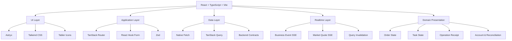
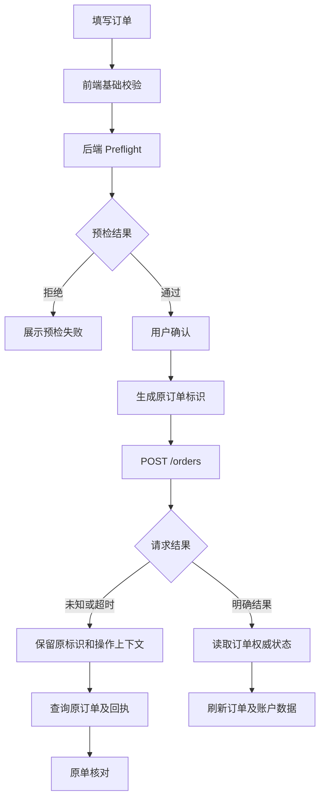

# 量化交易平台前端技术架构与实现可行性分析

**文档类型：** 前端技术架构提案 / 后端可行性审查  
**项目：** Binance Stocks 交易执行与管理系统  
**后端基线：** 3.0.0  
**文档日期：** 2026-11-09  
**审查对象：** 后端项目源码、公开 API 契约、数据库模型、业务服务、Worker、SSE 实现  
**文档状态：** 待后端源码审查，不代表最终技术方案已经通过验收。

---

# 一、文档目的

## 1.1 编写目的

本文件用于提出量化交易平台的前端技术选型、系统架构、业务模块划分、数据管理机制及前后端协作方案。

本方案以现有后端 3.0.0 为基础，不重新设计后端业务，不假设后端已经实现文档中未明确提供的能力。

本次审查的核心目标是：

1. 验证拟采用的前端技术栈是否与现有后端兼容。
2. 验证现有 API 是否足以支撑完整的前端业务功能。
3. 验证 SSE、REST API、TanStack Query 之间的数据协作方式。
4. 验证订单、批量任务、操作回执三套状态体系能否正确映射到前端。
5. 识别现有 API 契约、数据库模型和业务服务中可能影响前端实现的问题。
6. 识别需要后端补充的接口、字段、事件或数据能力。
7. 输出经过源码审查后的前端技术选型建议。

**本次任务不是让后端直接修改代码，而是先进行可行性分析，形成明确的审查结论。**

## 1.2 项目定位

本项目是面向 Binance Stocks 官方支持证券的交易执行与管理系统。

核心业务：

- 交易账户管理。
- 官方证券目录及行情查询。
- 单笔限价和市价交易。
- 批量交易任务管理。
- 官方订单与实际成交跟踪。
- 资金、持仓和费用管理。
- 本地名义持仓与账本。
- 账户及订单核对。
- 风险控制。
- 用户、权限和平台管理。

本项目不是以 K 线、技术指标、选股、策略研究或回测为核心的行情分析终端。

因此，本方案明确：

- 不建设 K 线图。
- 不引入专门的 K 线图表库。
- 不引入行情分析和回测框架。
- 不引入加密货币交易相关前端模块。
- 不建设本地撮合或虚拟交易环境。

前端主要负责业务交互、数据展示、操作控制、状态恢复和风险提示。

## 1.3 本次审查范围

需要审查：

- 后端 HTTP API。
- `backend/contracts/client.d.ts`。
- `backend/contracts/validation.ts`。
- SSE 消息及事件分发实现。
- 订单和任务状态机。
- 操作回执与幂等机制。
- 用户会话与 CSRF 机制。
- 账户、资产、订单、成交、账本等数据模型。
- API 与 Worker 的职责边界。
- 分页、筛选、排序及详情数据结构。
- 后端现有测试和契约验证方式。

不要求：

- 修改现有交易执行规则。
- 改变后端订单状态定义。
- 重构数据库。
- 重新设计交易 Worker。
- 为前端重新实现交易所 SDK。
- 将前端状态作为交易执行的权威依据。

---

# 二、拟采用的前端技术栈

## 2.1 技术栈总览

以下为当前拟采用的技术方案，尚需后端结合实际代码进行兼容性审查。

| 分类 | 技术 | 职责 | 选型状态 |
|---|---|---|---|
| UI Framework | React 19 | 前端 UI 框架 | 拟采用 |
| Language | TypeScript | 类型系统 | 拟采用 |
| Build Tool | Vite | 开发与构建 | 拟采用 |
| UI Design System | Astryx | UI 组件及设计系统 | 拟采用 |
| CSS Framework | Tailwind CSS v4 | 布局及样式 | 拟采用 |
| Design Tokens | Astryx CSS Variables | 颜色、字体、间距、主题 | 拟采用 |
| Icons | @tabler/icons-react | 全站图标 | 拟采用 |
| Router | TanStack Router | 路由及 URL 状态 | 拟采用 |
| Server State | TanStack Query | 服务端数据管理 | 拟采用 |
| Client State | Zustand | 前端本地状态 | 拟采用 |
| Form | React Hook Form | 表单管理 | 拟采用 |
| Validation | Zod | 前端运行时校验 | 拟采用 |
| Table | TanStack Table | 数据表格 | 拟采用 |
| Realtime | Native EventSource | SSE 实时通信 | 拟采用 |
| HTTP Client | Native Fetch | HTTP 请求 | 拟采用 |
| API Contract | Backend Contracts | 前后端类型契约 | 优先复用现有契约 |
| Decimal | decimal.js | 辅助精确十进制计算 | 按需采用 |
| Date | Native Intl API | 日期及数字格式化 | 优先采用 |
| Timezone | IANA Time Zone | 美股交易时区 | 必须支持 |
| i18n | i18next + react-i18next | 国际化 | 推荐 |
| Unit Test | Vitest | 单元测试 | 拟采用 |
| Component Test | React Testing Library | 组件测试 | 推荐 |
| E2E Test | Playwright | 端到端测试 | 拟采用 |
| API Mock | MSW | API 模拟 | 推荐 |
| Error Monitoring | Sentry | 前端异常监控 | 推荐 |

## 2.2 明确不引入的技术

| 技术 | 决定 | 原因 |
|---|---|---|
| MUI | 不引入 | 与 Astryx 功能重叠 |
| Chakra UI | 不引入 | 与 Astryx 功能重叠 |
| Ant Design | 不引入 | 与 Astryx 功能重叠 |
| Emotion | 不引入 | 不需要第二套 CSS-in-JS 方案 |
| StyleX | 不直接使用 | Astryx 内部实现即可 |
| TanStack Form | 不引入 | 已选择 React Hook Form |
| Redux Toolkit | 不引入 | 当前 Zustand 足够 |
| Axios | 不引入 | 原生 Fetch 足够 |
| WebSocket / Socket.IO | 不引入 | 现有后端提供 SSE |
| AG Grid | 暂不引入 | 优先验证 TanStack Table |
| TanStack Virtual | 按需引入 | 先使用后端分页 |
| ECharts | 暂不引入 | 当前没有明确图表需求 |
| Lightweight Charts | 不引入 | 不需要 K 线图 |
| React Compiler | 暂不引入 | 先进行实际性能测试 |
| date-fns | 暂不引入 | 当前优先使用原生 Intl API |
| Hono RPC | 暂不确定 | 先审查现有后端契约 |

注意：上述选择是前端技术提案，不意味着后端必须采用相同的依赖或架构。

---

# 三、前端整体架构

## 3.1 架构分层

前端采用业务模块化架构，主要划分为五层：

### 第一层：UI Layer

负责视觉表现和交互组件。

技术：

- Astryx。
- Tailwind CSS。
- Astryx CSS Variables。
- Tabler Icons。

职责：

- 基础组件。
- 页面布局。
- 表格视觉。
- 弹窗和抽屉。
- 表单控件。
- 状态标签。
- 通知提示。
- 深色模式。

### 第二层：Application Layer

负责页面路由、业务流程和用户交互。

技术：

- React。
- TanStack Router。
- React Hook Form。
- Zod。

职责：

- 页面路由。
- 角色路由。
- 表单状态。
- 用户交互。
- 页面级业务流程。
- 参数和输入校验。

### 第三层：Data Layer

负责后端数据获取、缓存及同步。

技术：

- TanStack Query。
- Native Fetch。
- Backend Contracts。

职责：

- REST API。
- 查询缓存。
- 分页查询。
- 数据刷新。
- Mutation。
- 错误处理。
- 数据一致性。

### 第四层：Realtime Layer

负责后端 SSE 实时事件处理。

技术：

- Native EventSource。
- TanStack Query。
- Zustand（仅管理必要的客户端状态）。

职责：

- 业务事件接收。
- 行情事件接收。
- 资源刷新。
- SSE 连接生命周期。
- 断线恢复。
- 行情状态展示。

### 第五层：Domain Presentation Layer

负责将后端业务对象和状态映射为前端展示模型。

职责：

- 订单状态映射。
- 任务状态映射。
- 操作回执状态映射。
- 账户状态映射。
- 资金和库存数据表达。
- 权限控制。
- 风险提示。
- 未知结果恢复界面。

该层不重新实现后端金融规则，不自行推进交易状态。

## 3.2 架构示意



---

# 四、前端业务模块规划

前端业务模块按照现有后端业务领域组织。

## 4.1 身份认证与会话管理

对应后端接口：

| 方法 | 接口 |
|---|---|
| POST | `/auth/login` |
| GET | `/auth/me` |
| POST | `/auth/logout` |
| POST | `/auth/password` |

前端功能：

- 登录。
- 退出。
- 当前用户信息。
- 会话有效性检查。
- CSRF Token 管理。
- 密码修改。
- 会话失效处理。

需要重点验证：

1. 登录响应中的 CSRF 字段。
2. `/auth/me` 的完整返回结构。
3. HttpOnly Cookie 的配置。
4. 请求是否必须使用 `credentials`。
5. CSRF Token 是否在密码修改后发生变化。
6. 401 和 403 的具体错误结构。
7. 多标签页会话状态如何同步。

特别注意：

后端使用 HttpOnly Cookie，不应在前端保存会话令牌。

所有写请求必须统一携带 `X-CSRF-Token`。

旧会话请求返回的迟到 401 不应污染新登录会话的前端状态。前端需要会话代次管理、取消旧请求；但 Cookie 被旧响应删除的根本风险仍需后端修复。

## 4.2 账户管理

对应后端接口：

| 方法 | 接口 |
|---|---|
| GET | `/accounts` |
| POST | `/accounts` |
| GET | `/accounts/:id` |
| PATCH | `/accounts/:id` |
| POST | `/accounts/:id/check` |
| POST | `/accounts/:id/assets/sync` |
| POST | `/accounts/:id/reconcile` |

前端功能：

- 账户列表。
- 账户详情。
- 账户凭据登记。
- 账户标签修改。
- 账户交易开关。
- 账户连接检查。
- 资产同步。
- 账户核对。
- 账户状态展示。

需要重点区分：

| 状态 | 展示含义 |
|---|---|
| 连接成功 | 最近一次连接检查成功 |
| 连接失败 | 最近一次连接检查失败 |
| 未检查 | 尚无有效检查结果 |
| 交易关闭 | 账户当前不允许新增交易 |
| 平台限制 | 管理员设置的账户限制 |
| 资产同步失败 | 当前同步未成功 |
| 旧快照保留 | 历史数据存在，但不能作为当前可用资产 |

账户创建不代表官方连接成功。

账户连接成功也不代表账户已经具备实际交易资格。

## 4.3 证券与行情

对应后端接口：

| 方法 | 接口 |
|---|---|
| GET | `/market/symbols` |
| GET | `/market/holdings` |
| GET | `/market/quotes` |
| GET | `/market/quote-stream` |

前端功能：

- 官方证券目录。
- 证券搜索。
- 证券交易规则。
- 账户持仓候选。
- 单证券报价。
- 行情状态。
- 报价更新时间。
- 行情异常状态。

不建设：

- K 线图。
- 技术指标。
- 策略分析。
- 回测。

行情数据需要明确：

- 最新报价。
- 报价来源。
- 报价时间。
- 行情状态。
- 数据是否过期。
- 当前是否存在有效报价。

不能把旧报价伪装成实时行情。

### 行情 SSE 设计

后端提供：

`GET /api/v1/market/quote-stream`

拟采用：

- REST 获取初始数据。
- EventSource 接收后续更新。
- 断线后重新获取 REST 快照。
- 统一管理订阅和连接。
- 不允许组件自行建立 SSE 连接。

需要后端确认：

1. 一个 SSE 连接是否只能订阅一支证券。
2. 是否支持多证券订阅。
3. 证券参数的格式。
4. 首次连接是否包含完整快照。
5. 报价和状态事件的 JSON Schema。
6. 报价时间字段的精度和时区。
7. SSE 是否会在账户切换后自动失效。
8. 行情补读的触发条件。

当前后端限制同一用户两类 SSE 总计最多 6 条活动连接。

如果行情连接按证券独立建立，必须评估自选列表的订阅数量和连接复用策略。

## 4.4 单笔订单

对应后端接口：

| 方法 | 接口 |
|---|---|
| POST | `/orders/preflight` |
| POST | `/orders` |
| GET | `/orders` |
| GET | `/orders/:id` |
| POST | `/orders/:id/cancel` |
| POST | `/orders/:id/reconcile` |

前端功能：

- 单笔买入。
- 单笔卖出。
- 限价订单。
- 市价买入。
- 市价卖出。
- 交易预检。
- 订单提交。
- 订单详情。
- 撤单。
- 原单核对。

前端需要严格区分三类交易输入：

| 类型 | 用户输入 |
|---|---|
| 限价买入 / 卖出 | 价格 + 股数 |
| 市价买入 | 本金 |
| 市价卖出 | 股数 |

市价买入不能按照指定股数的订单进行展示。

### 订单提交流程



注意：

- 预检通过不代表订单受理。
- HTTP 请求成功不代表订单成交。
- 请求超时不代表订单失败。
- 同一订单意图不得因为刷新页面而重新生成提交标识。
- 未知结果不得自动重发。
- 撤单未知结果不得重复发送撤单请求。

订单提交使用 `Idempotency-Key`。

前端必须保存原请求标识和与其关联的业务上下文。

需要确认该标识的持久化和恢复策略，不能仅保存在 React 组件状态中。

## 4.5 批量任务

对应后端接口：

| 方法 | 接口 |
|---|---|
| GET | `/tasks` |
| POST | `/tasks` |
| GET | `/tasks/:id` |
| PATCH | `/tasks/:id` |
| POST | `/tasks/:id/control` |

前端功能：

- 任务列表。
- 任务创建。
- 任务配置编辑。
- 任务详情。
- 任务启动。
- 任务暂停。
- 任务继续。
- 任务停止。
- 任务核对。
- 执行进度。
- 关联订单。
- 关联成交。
- 执行事件和诊断。

批量任务配置需要覆盖：

- 账户。
- 证券。
- 买卖方向。
- 订单类型。
- 目标股数或本金。
- 批次数量。
- 固定或随机批次。
- 固定或随机间隔。
- 计划开始时间。
- 执行窗口。
- 执行模式。
- 限价取价规则。
- 价格舍入策略。
- 尾量策略。
- 挂单处理策略。
- 交易时段。
- 有效期。

表单使用 React Hook Form + Zod。

任务保存和任务启动必须分开处理。

任务创建只保存配置，不自动启动，也不代表资金已经预留。

任务启动需要调用后端重新预检。

### 任务状态展示

前端必须支持后端全部公开任务状态：

| 状态 | 展示原则 |
|---|---|
| CREATED | 已创建 |
| READY | 待启动 |
| SCHEDULED | 已预约 |
| RUNNING | 执行中 |
| PAUSED | 已暂停 |
| RECONCILING | 核对中 |
| RECOVERY_REQUIRED | 需要恢复处理 |
| STOPPING | 停止处理中 |
| COMPLETED | 已完成 |
| EXPIRED | 执行窗口结束 |
| STOPPED | 已停止 |
| FAILED | 执行失败 |

如果后端返回 `VALIDATING`，前端也应根据真实状态定义进行兼容，不能因为文档中它属于公开定义的预检状态，就擅自认为所有接口都会返回它。

必须根据实际枚举和状态转换规则确定按钮可用性。

### 任务编辑

后端 PATCH 使用完整配置替换，而不是任意字段合并。

前端必须：

1. 获取完整任务配置。
2. 构建完整表单。
3. 校验完整配置。
4. 提交完整配置。
5. 重新读取任务详情。

不能只提交用户修改的单个字段。

对于已经运行的任务，必须尊重后端对可编辑字段和执行窗口的限制。

## 4.6 订单、成交、持仓和账本

对应后端接口：

| 方法 | 接口 |
|---|---|
| GET | `/orders` |
| GET | `/orders/:id` |
| GET | `/tasks/:id` |
| GET | `/positions` |
| GET | `/ledger` |
| GET | `/accounts/:id/exchange/orders` |
| GET | `/accounts/:id/exchange/trades` |

前端需要区分：

- 本地订单。
- 官方订单历史。
- 本地成交。
- 官方成交历史。
- 本地名义持仓。
- 官方持仓候选。
- 本地账本。
- 实际费用与预留费用。

这些数据不能混为同一种业务对象。

尤其不能将本地名义持仓展示成账户的完整官方持仓。

也不能将官方历史查询结果自动当作本地订单或完整现金结算记录。

### 分页限制

需要根据资源实际能力分别实现：

| 资源 | 后端行为 |
|---|---|
| 本地订单 | 分页 |
| 任务 | 分页 |
| 用户 | 分页 |
| 管理员账户 | 分页 |
| 账本 | 分页 |
| 审计 | 分页 |
| 业务日志 | 分页 |
| 官方订单历史 | 指定页读取 |
| 官方成交历史 | 指定页读取 |
| 核对记录 | 返回数组 |
| 普通账户列表 | 返回数组 |
| 本地全局成交 | 暂无独立分页接口 |

不要在前端统一假设所有列表都有相同的分页、排序和筛选能力。

## 4.7 操作回执与恢复

对应后端接口：

| 方法 | 接口 |
|---|---|
| GET | `/operations` |
| GET | `/operations/:id` |
| POST | `/operations/:id/reconcile` |

这是一个独立的核心业务模块。

前端应建立 Operation Recovery 页面或统一恢复面板。

需要支持：

- 查看未解决操作。
- 查看原操作详情。
- 查看操作目标。
- 查看处理阶段。
- 查看原始参数。
- 查看冻结结果。
- 查看操作结论。
- 发起允许的原操作核对。

操作回执状态：

- PROCESSING。
- UNKNOWN。
- CONFLICT。
- REJECTED。
- SUCCEEDED。

注意：

SUCCEEDED 仅代表该类型操作定义的处理流程完成，不统一代表连接成功、订单成交或任务完成。

不同操作类型必须使用不同的恢复策略。

不能假设所有写操作都存在统一的 `/operations` 回执。

---

# 五、前端状态管理设计

## 5.1 TanStack Query

TanStack Query 是前端服务端状态的主要管理工具。

负责：

- 用户信息。
- 账户数据。
- 资产快照。
- 证券目录。
- 行情 REST 快照。
- 订单。
- 任务。
- 成交。
- 持仓。
- 账本。
- 核对记录。
- 操作回执。
- 管理数据。
- 系统状态。

原则：

**REST 是业务数据读取来源，TanStack Query 负责缓存和数据同步。**

## 5.2 Zustand

Zustand 仅负责前端本地状态：

- 侧边栏展开状态。
- 当前页面工作区。
- 当前选中账户。
- 当前选中证券。
- 用户界面偏好。
- 全局弹窗。
- 通知面板。
- 必要的 SSE 连接状态。

不建议把所有后端业务对象复制到 Zustand。

## 5.3 SSE 与 TanStack Query

后端存在两条独立 SSE：

### 业务 SSE

`GET /api/v1/events`

业务 SSE 只通知资源变化，不提供完整业务数据。

建议处理流程：

```text
Business SSE
    ↓
解析资源变化提示
    ↓
Resource Dispatcher
    ↓
TanStack Query Invalidate
    ↓
REST 重新读取
    ↓
更新页面
```

需要后端提供完整的资源事件类型、载荷结构和触发条件。

### 行情 SSE

`GET /api/v1/market/quote-stream`

建议处理流程：

```text
REST 获取初始报价
    ↓
建立 EventSource
    ↓
接收 quote / status
    ↓
校验数据
    ↓
更新行情 Store
    ↓
更新对应 UI
```

行情状态和报价数据必须分开管理。

SSE 断线时：

- 标记连接状态。
- 标记报价新鲜度。
- 重新建立连接。
- 重新读取 REST 快照。
- 不伪造实时状态。

## 5.4 SSE 连接管理

建议建立独立的 `SSE Manager`。

```text
services/realtime/
├── sse-manager.ts
├── business-stream.ts
├── market-stream.ts
├── event-parser.ts
├── resource-dispatcher.ts
└── connection-state.ts
```

需要重点考虑：

- EventSource 生命周期。
- 页面切换。
- 账户切换。
- 用户退出。
- 权限变化。
- 自动重连。
- 重连后的资源重新获取。
- 同一用户的连接数量限制。
- 多标签页连接协调。

特别注意：EventSource 自动重连不代表事件补播。后端没有提供历史游标和事件补播能力，前端必须以重新读取 REST 数据作为恢复基础。

需要评估多标签页是否共享 SSE 连接，以及共享机制的复杂度是否值得。

---

# 六、前后端 API 与契约设计

## 6.1 现有契约优先

当前后端提供：

- `backend/contracts/client.d.ts`
- `backend/contracts/validation.ts`

前端优先复用这两个文件。

本阶段不默认引入 Hono RPC，也不默认重新生成一套 API 类型。

需要后端检查：

1. 两份文件是否覆盖全部 52 个 HTTP 方法与路径组合。
2. 是否包含全部成功响应。
3. 是否包含全部错误响应。
4. 是否准确描述 `null` 和可选字段。
5. 是否包含所有枚举值。
6. 是否包含分页结构。
7. 是否包含 SSE 消息类型。
8. 是否包含原操作回执结构。
9. 是否能够独立导出并供前端项目使用。
10. 是否存在运行时校验与静态声明不一致的情况。

## 6.2 API Client

建议建立统一 API Client。

```text
services/api/
├── client.ts
├── request.ts
├── response.ts
├── errors.ts
├── csrf.ts
├── session.ts
└── resources/
    ├── auth.ts
    ├── accounts.ts
    ├── market.ts
    ├── orders.ts
    ├── tasks.ts
    ├── positions.ts
    ├── ledger.ts
    ├── operations.ts
    └── admin.ts
```

要求：

- 使用原生 Fetch。
- 统一处理 Cookie。
- 统一处理 CSRF。
- 统一解析响应。
- 统一解析业务错误。
- 保留原始 HTTP 状态。
- 保留服务端错误码。
- 保留原操作回执。
- 不自动重试有副作用的写操作。

特别是：

HTTP 409 不应自动转换成普通表单错误。

HTTP 401 不应无条件触发写请求重试。

请求超时不能直接解释为订单提交失败。

## 6.3 金融数值类型

后端已经明确使用精确十进制字符串传输金融数据。

前端需要保留该约定。

例如：

```ts
interface Position {
  symbol: string;
  quantity: string;
  averagePrice: string | null;
  marketValue: string | null;
  unrealizedPnl: string | null;
}
```

实际字段必须以源码契约为准，以上仅为结构示意。

原则：

- 不将金融十进制字符串自动转换成 JavaScript number。
- 输入框优先保留字符串。
- 计算需要时使用 Decimal.js。
- 金额展示使用 Intl.NumberFormat。
- 未知值不能转换成 0。
- 旧快照不能伪装成当前值。

## 6.4 日期与时间

计划开始时间使用 UTC ISO 8601 `Z` 字符串。

前端必须：

- 保留原始时间精度。
- 避免未经确认的自动舍入。
- 正确处理最多六位有效小数秒。
- 区分 UTC、America/New_York 和用户本地时区。
- 对时间编辑使用明确的时区语义。

特别注意：JavaScript 原生 Date 不能完整保留六位小数秒。

因此，计划时间的解析、编辑和序列化必须单独验证，不能直接依赖 Date 对象往返转换。

需要后端确认实际字段的序列化格式和允许的精度。

---

# 七、权限与安全设计

## 7.1 角色权限

前端区分：

- 交易员。
- 平台管理员。

权限表：

| 功能 | 交易员 | 管理员 |
|---|---|---|
| 查看本人账户 | 允许 | 允许查看授权范围 |
| 提交订单 | 允许 | 禁止 |
| 撤单 | 允许 | 禁止 |
| 创建任务 | 允许 | 禁止 |
| 编辑本人任务 | 按任务状态允许 | 禁止 |
| 启动任务 | 允许 | 禁止 |
| 暂停任务 | 允许 | 允许 |
| 继续任务 | 允许 | 禁止 |
| 停止任务 | 允许 | 允许 |
| 核对任务 | 允许 | 允许 |
| 查看跨用户业务 | 禁止 | 允许 |
| 管理用户 | 禁止 | 按专项权限 |
| 平台急停 | 禁止 | 允许 |
| 平台设置 | 禁止 | 允许 |

前端权限控制仅用于 UI 展示和操作引导。

最终权限以服务端校验为准。

## 7.2 安全要求

- 不在前端保存 API Secret。
- 不在 localStorage 保存会话令牌。
- 使用 HttpOnly Cookie。
- 所有写请求正确携带 CSRF Token。
- 账户切换时清理不属于当前账户的缓存。
- 退出登录时清理敏感缓存。
- 不在日志中输出交易凭据。
- 不在浏览器中自行构造官方签名。
- 不绕过后端交易限制。
- 不通过隐藏按钮代替权限验证。

---

# 八、建议的前端项目目录

```text
frontend/
├── public/
│
├── src/
│   ├── app/
│   │   ├── router.tsx
│   │   ├── providers.tsx
│   │   ├── permissions.ts
│   │   └── layouts/
│   │
│   ├── components/
│   │   ├── ui/
│   │   ├── shared/
│   │   └── data-table/
│   │
│   ├── features/
│   │   ├── auth/
│   │   ├── dashboard/
│   │   ├── accounts/
│   │   ├── market/
│   │   ├── orders/
│   │   ├── tasks/
│   │   ├── positions/
│   │   ├── ledger/
│   │   ├── reconciliations/
│   │   ├── operations/
│   │   ├── administration/
│   │   └── system/
│   │
│   ├── services/
│   │   ├── api/
│   │   └── realtime/
│   │
│   ├── stores/
│   │   ├── auth/
│   │   ├── ui/
│   │   └── market/
│   │
│   ├── hooks/
│   ├── schemas/
│   ├── theme/
│   ├── i18n/
│   ├── lib/
│   └── styles/
│
├── tests/
│   ├── unit/
│   ├── integration/
│   └── e2e/
│
├── package.json
├── tsconfig.json
└── vite.config.ts
```

采用按业务领域划分的 Feature 模块。

每个 Feature 可以独立包含：

```text
orders/
├── api/
├── components/
├── hooks/
├── schemas/
├── types/
├── utils/
└── routes/
```

不要求所有模块必须使用完全相同的内部结构，应以实际复杂度为准。

---

# 九、测试与验收要求

## 9.1 API 契约测试

验证前端对现有后端公开契约的正确使用。

重点：

- 请求字段。
- 响应字段。
- 枚举。
- 可空字段。
- 错误结构。
- 分页。
- SSE 事件。
- CSRF。
- 权限错误。

## 9.2 订单流程测试

至少覆盖：

1. 预检通过。
2. 预检拒绝。
3. 订单明确受理。
4. 订单明确拒绝。
5. 提交超时。
6. 提交结果未知。
7. 页面刷新后恢复原订单上下文。
8. 重复提交保护。
9. 撤单成功。
10. 撤单结果未知。
11. 原单核对。
12. 部分成交。
13. 成交后费用待核实。

## 9.3 批量任务测试

至少覆盖：

- 创建任务。
- 编辑任务。
- 预约任务。
- 启动任务。
- 暂停任务。
- 继续任务。
- 停止任务。
- 核对任务。
- 任务恢复。
- 窗口到期。
- EXACT 尾量。
- FIXED 尾量。
- 自动撤单。
- 账户限制。
- 平台急停。

## 9.4 账户数据测试

至少覆盖：

- 当前资金为零。
- 资金未知。
- 钱包读取失败。
- 旧资产快照。
- 资产同步成功。
- 资产同步失败。
- 官方库存为零。
- 官方库存未知。
- 持仓候选与可卖库存不同。
- 账户核对 DIFFERENCE。
- 账户核对 UNAVAILABLE。
- 账户核对 PARTIAL。

## 9.5 SSE 测试

至少覆盖：

- 首次连接。
- 正常接收。
- 网络中断。
- 自动重连。
- 重连后重新读取资源。
- 用户退出。
- 账户切换。
- 权限变化。
- 行情过期。
- 业务通知重复。
- SSE 连接数量限制。

## 9.6 关键安全测试

特别验证：

- 旧会话迟到 401。
- 新旧会话请求交错。
- CSRF Token 失效。
- 账户缓存隔离。
- 越权资源读取。
- 管理员尝试执行交易员专属操作。
- 交易员尝试访问管理员资源。

---

# 十、需要后端重点审查的问题清单

请结合实际代码逐项审查，不要仅根据本文件的设计描述判断。

## A. API 与契约

1. `client.d.ts` 是否完整覆盖全部公开接口？
2. `validation.ts` 与实际运行时校验是否一致？
3. 所有接口的成功和错误响应结构是否可以准确映射？
4. `null`、缺失字段和空数组是否存在语义差异？
5. 分页接口是否存在不一致的字段命名和行为？
6. 是否可以将现有公开契约独立提供给前端工程？
7. 当前是否存在未写入静态声明的运行时字段？

## B. SSE

1. 两条 SSE 的实际消息 JSON Schema 是什么？
2. 业务 SSE 的资源类型清单是什么？
3. 业务事件是否提供足够信息定位对应 Query Key？
4. 行情 SSE 是否支持多证券订阅？
5. 行情 SSE 的首帧是否包含完整快照？
6. SSE 重连是否有任何补播或序列号机制？
7. 同一用户两类流最多六条连接的计数是否跨 API 实例？
8. 是否存在前端切换账户后旧流仍继续推送数据的情况？
9. 两条 SSE 是否可以通过 EventSource 原生接口正常使用会话 Cookie？
10. 是否需要补充事件版本号？

## C. 订单与幂等

1. 下单 `Idempotency-Key` 的实际指纹和有效期规则是什么？
2. 前端如何在页面刷新后恢复原订单意图？
3. 是否存在可以查询原订单提交结果的完整接口？
4. 原订单核对需要哪些前置条件？
5. 撤单和任务控制 UUID 的生成及参数绑定规则是什么？
6. 原操作回执是否包含足够的恢复信息？
7. 哪些写操作没有持久回执？
8. 哪些错误可以安全重试，哪些绝对不能重试？

## D. 任务状态与表单

1. 实际任务状态枚举是否与文档完全一致？
2. 所有状态转换是否合法？
3. 不同状态下允许编辑的字段是否可以通过接口或公开契约明确表达？
4. PATCH 是否始终要求完整配置？
5. 任务启动与继续的前置检查分别是什么？
6. 任务详情中的订单、成交和事件是否存在数组规模上限？
7. 是否存在任务详情无法通过现有接口完整展示的情况？

## E. 账户、资产与账本

1. 资产快照中的时间、来源和失败状态字段是否完整？
2. 是否能够明确区分当前值、旧快照、未知值和已确认零值？
3. 官方库存是否能提供完整的证券身份、可用股数和来源时间？
4. 本地名义持仓和官方持仓是否存在容易混淆的字段？
5. 费用预留和实际费用是否有明确区分？
6. 账户核对是否能够完整展示 DIFFERENCE、UNAVAILABLE、PARTIAL 的原因？
7. 是否需要独立的本地成交分页接口？

## F. 会话和权限

1. Cookie、CSRF、Origin 校验是否与前端跨源部署方式兼容？
2. 是否存在旧请求 401 删除新会话 Cookie 的风险？
3. 多标签页之间会话状态如何同步？
4. 账户切换是否需要重新检查权限？
5. 禁用用户后已建立的 SSE 是否能够及时终止？
6. 管理员专项权限 `canManageAdmins` 如何体现在当前身份响应中？

## G. 工程集成

1. 后端是否支持前端独立开发服务器运行？
2. Vite 开发代理如何配置？
3. 生产环境前后端是否需要同源部署？
4. 是否有明确的前端 API Base URL 配置方式？
5. 现有公开契约能否被前端直接导入？
6. 是否需要为 SSE 增加测试工具或契约测试？
7. 当前部署方案是否能够正确配置 Cookie、HTTPS 和 Origin？

---

# 十一、需要后端输出的审查结果

请不要直接开始实现前端，也不要仅回复技术选型是否合理。

希望按照以下结构给出正式审查报告。

## 11.1 总体可行性结论

分别评价：

- 完全可行。
- 有条件可行。
- 需要调整。
- 当前无法实现。

并说明原因。

## 11.2 技术选型审查表

对第二章的每项技术给出：

| 字段 | 说明 |
|---|---|
| 原选型 | 当前提出的技术 |
| 审查结果 | 通过 / 有条件通过 / 不通过 |
| 源码依据 | 对应实际文件和代码位置 |
| 兼容性问题 | 发现的问题 |
| 替代建议 | 更合理的选型 |
| 是否需要后端修改 | 是 / 否 |
| 修改优先级 | P0 / P1 / P2 |

## 11.3 API 契约审查

输出：

- 完全可用的接口。
- 缺少字段的接口。
- 类型定义不完整的接口。
- 响应结构不统一的接口。
- 前端需要额外转换的接口。
- 建议补充的接口。

必须给出真实代码依据。

## 11.4 SSE 审查

输出：

- 两条 SSE 的实际数据结构。
- 实际消息示例。
- 连接限制。
- 重连行为。
- 账户隔离行为。
- 资源通知与 Query Key 的映射建议。
- 前端实现限制。
- 是否需要后端调整。

## 11.5 业务状态审查

分别梳理：

- 订单状态。
- 任务状态。
- 操作回执状态。
- 账户连接状态。
- 资产同步状态。
- 账户核对状态。

需要指出哪些状态可以直接展示，哪些状态需要额外查询，哪些状态不能由前端推断。

## 11.6 后端改进建议

将建议分为：

- P0：不解决将阻碍前端正确实现或存在明显安全、交易正确性风险。
- P1：建议在前端正式开发前完成。
- P2：可以在后续迭代解决。

每项必须说明：

1. 当前问题。
2. 源码依据。
3. 影响的前端模块。
4. 建议修改内容。
5. 是否涉及数据库变更。
6. 是否影响现有业务行为。

不要为了配合前端选型而无必要地修改已经正确运行的后端业务逻辑。

## 11.7 最终技术栈修订

根据审查结果重新输出最终技术栈：

- 保留项。
- 替换项。
- 新增项。
- 删除项。
- 暂缓项。

并解释每项调整的原因。

## 11.8 前后端联调前置条件

给出正式开始前端实现之前必须完成的条件。

至少包含：

- API 契约确认。
- SSE 契约确认。
- Cookie 与 CSRF 确认。
- 状态机映射确认。
- 分页和筛选确认。
- 操作回执恢复机制确认。
- 前端运行环境和跨源配置确认。

---

# 十二、审查原则与约束

本次审查需要遵循以下原则：

1. 以当前后端 3.0.0 实际源码为依据，而不是仅以本文件为依据。
2. 不假设接口已经实现文档未描述的功能。
3. 不擅自修改后端业务规则以迎合前端组件。
4. 不将 HTTP 成功视为交易成功。
5. 不将预检通过视为交易许可或资金锁定。
6. 不将未知订单结果视为失败。
7. 不将 SSE 资源通知视为完整业务数据。
8. 不将本地名义持仓视为官方完整持仓。
9. 不将核对记录的完成视为账户全量一致。
10. 不将前端权限隐藏视为后端授权。
11. 不将前端 Zod 校验视为后端交易规则校验。
12. 不自动重发结果未知的订单或撤单操作。
13. 不引入没有实际业务需求的额外技术依赖。
14. 发现文档与源码不一致时，以实际源码和可复现行为为依据，并单独记录差异。
15. 对无法从源码确认的事项明确标注为待验证，不要自行推断。

**最终目标不是证明这套技术栈一定正确，而是找出它与真实后端之间的所有不兼容点，并在正式前端开发之前解决关键问题。**

---

# 十三、最终交付要求

请最终提供：

1. 《前端技术栈可行性审查报告》
2. 《前后端 API 契约差异清单》
3. 《SSE 事件及连接机制分析》
4. 《订单、任务与操作回执前端映射规范》
5. 《后端需要补充或修复的问题清单》
6. 《修订后的前端技术选型》
7. 《前后端联调前置条件清单》

每份报告必须包含实际源码路径、关键函数或类型名称，必要时附上相关代码片段。

如果没有发现问题，也应明确说明检查了哪些文件和路径，不能只写“没有问题”。

本次只进行代码审查和可行性分析，**未经进一步授权，不要修改后端源码、数据库结构、接口行为或业务状态机。**
