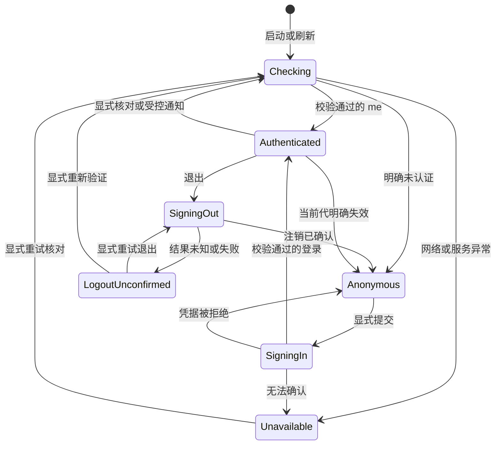

# 前端第二阶段实施与验证

- 状态：已执行（本轮记录定稿，后续变化另建记录）
- 执行日期：2026-11-10
- 范围：`frontend/`、私有本地 `api-contracts/`、必要文档与索引
- 前置：[第二阶段任务书](0001-stage2-start-agent-prompt.md)、[第一阶段最终准入记录](../0069-frontend-r2-01-identity-fix/0002-fix-and-targeted-verification.md)
- 后端：3.0.0，保持只读；未启动后端、Worker、数据库、官方 SDK 或真实账户连接

## 1. 结论

**第二阶段指定的本地实现范围可验收。** Hono RPC 已实际承担本阶段认证 API 调用；登录、退出、恢复、Session Epoch、旧请求隔离、权限守卫、Astryx AppShell、最小业务 SSE 生命周期与授权 Query 收敛均已落地。

最终完整执行：类型检查、lint、契约检查、主题检查、生产构建全部通过；Vitest **20 文件、420 项通过**，coverage 再次运行同样 **420 项通过**；Chromium **35 项全部通过，未重试**。本轮发现的路由 pending 循环与移动导航控件隐藏问题已修复并进入最终回归。

本轮范围内未识别到尚未关闭的新增 P0/P1。**这不是生产发布、真实后端联调或真实资金准入结论。** 未联调事项、迟到 Set-Cookie 风险、历史 P2、构建体积与部署条件见第 10 节。不自动进入下一阶段。

## 2. 审查和实施基线

| 项目 | 实际记录 |
|---|---|
| 分支 | `astryx-dev`，本轮未切换 |
| 开始及结束 HEAD | `0427627f3637b4363a51b5c1a79de65791237783`，未提交或推送 |
| 开始暂存区 | 空 |
| 开始已有修改 | 9 个已跟踪文件差异，`+776/-137`；另有 0068、0069、`api-identity.typecheck.ts` 未跟踪输入 |
| 结束暂存区 | 空 |
| 最终已跟踪差异统计 | 27 文件，`+1250/-435`；包含开工已有 R2-01 改动，不全部归因本阶段 |
| 后端结束状态 | `git status --short -- backend`、`git diff --name-status -- backend` 均无输出 |

**第一阶段 R2-01 最终修复位于开工已有的未提交工作区，并不完整包含在上述 HEAD 中。** 本轮对象是该 HEAD、已有 R2-01 工作区修复及本阶段新增实现的组合；没有把修复前 HEAD 冒充第一阶段最终验收版本。

开工即执行 `bun run typecheck && bun run test:run tests/unit/api-errors.test.ts tests/integration/api-client.test.ts`，退出 0，205 项通过。0066～0069 历史记录未覆盖；第一阶段判定文件、原身份类型负例、金融/时间实现与生成主题的 SHA-256 均与开工相同。

## 3. 本地契约与 Hono RPC

### 3.1 生成、同步、消费

- 后端现有 `backend/scripts/contract-entry.ts` 使用 `hc<AppType>()` 形成展开声明；本阶段直接复用已经存在的 `backend/contracts/client.d.ts` 和 `validation.ts`，没有重新设计契约。
- 两份公开产物逐字节复制到 `api-contracts/`。`index.d.ts` 仅导出 `ApiClient` 类型，校验规则通过 `@project/api-contracts/validation` 消费。没有虚构根运行时工厂。
- 前端新增依赖 `"@project/api-contracts": "file:../api-contracts"`，Hono 精确 `4.13.13`，与后端实际清单一致。保持两个独立应用、独立清单和锁文件，无根 Workspace、npm 发布或直接后端源码导入。
- `api-contracts/scripts/sync.ts` 只复制已有公开产物；`--check` 核对后端、本地和安装后的消费副本，并校验 Hono 版本与公开导入白名单。没有运行后端导出命令——现有导出器即使 `--check` 也可能写入后端构建目录，不符合本轮只读边界。
- 本机 Bun 使用文件链接安装本地包。TypeScript、Vite、Vitest 保留包链接位置，并去重 React/React DOM/Zod/Hono，避免从真实链接目标找不到前端 peer dependencies。没有手工伪造安装副本或建立第二套依赖树。

| 公开产物 | 后端及本地相同 SHA-256 |
|---|---|
| `client.d.ts` | `8b3aea58843c6e0d86d6cd9137239996b80d1d0d348c8c09df76e758462993d2` |
| `validation.ts` | `1710f710a6051f3660bd72bd5e250f666a3c582eb62de9c4f86afd2b24a4e875` |

更新流程：后端在单独授权工作中生成公开产物 → 前端 `contracts:sync` → 安装本地依赖 → `contracts:check` → 类型检查。源文件变了不等于安装消费副本已更新；检查发现陈旧副本必须失败。

### 3.2 真实调用与类型绑定

`services/api/rpc.ts` 是唯一客户端创建位置：调用 `hc(root, { fetch })`，对后端已经展开的 `ApiClient` 做一次局部最小类型绑定。**没有 `hc<ApiClient>()`，没有把 ApiClient 当 AppType。** 业务及认证调用方没有分散类型断言。

`features/auth/api.ts` 实际使用生成客户端的：

- `client.api.v1.auth.login.$post({ json: input })`
- `client.api.v1.auth.me.$get()`
- `client.api.v1.auth.logout.$post()`

请求/响应类型通过 `InferRequestType`、`InferResponseType` 派生；输入规则复用公开 loginSchema。未重复定义正式用户、登录、退出 DTO。后端没有公开完整认证响应 Schema，因此只对本阶段实际使用的 UUID、用户名、角色、专项权限、43 位 CSRF 以及 `loggedOut:true` 建立最小运行时校验；缺字段不补默认角色或令牌，TRADER 不接受管理员专项标志。

`rpc-contract.typecheck.ts` 包含合法调用及路径、参数、输入、响应类型负例；与原 `api-identity.typecheck.ts` 一同进入实际 `tsc -b --noEmit`。泛型声明没有被冒充运行时网络数据验证。

## 4. 统一传输及第一阶段边界

`executeJsonRequest` 是 RPC 和既有 `requestJson` 的共同传输；`consumeJsonResponse` 是共同正文消费和响应判断。Hono 自定义 Fetch 返回原生 `Response`，不会注入返回 ApiOutcome 的 requestJson，也不会提前读正文。

| 边界 | 本阶段实现 |
|---|---|
| 单次发送/消费 | 一次逻辑调用最多调用一次底层 Fetch；统一只读一次 `Response.text()`，第二次发送被拒绝 |
| Cookie/CSRF | 原生 `credentials:include`、`cache:no-store`；发送当时读取 CSRF；注销使用隔离前保存的原令牌 |
| body 超时/取消 | 截止时间覆盖 Fetch 和正文读取，外部及业务会话 signal 合并，销毁时清除监听/定时器 |
| HTTP/业务语义 | 非 2xx 回执、503 data、畸形正文及 receipt absent/valid/invalid 三态保留 |
| 原意图 | attempt 与 intent 仍独立，缺失/空/部分/错配身份不能得到终态；完整匹配正例仍可 applied/not-applied |
| 身份来源 | 仍来自发送前保存的原请求；不从收到的 operation 反构 expected |
| 未知结果 | 已发送后的超时、断网、取消不等于服务端未执行；AbortSignal 不撤销后端操作 |
| 迟到响应 | 请求先捕获 epoch；旧结果以 `StaleSessionResponseError.outcome` 保留证据，不写当前 UI/Query 或触发新会话退出 |
| 敏感写 | 原 `createSensitiveWriteGate`、`networkMode:always`、`retry:false` 保留；不新增离线续发、换 key、重放或持久化恢复 |

本阶段没有真实交易 Mutation，不能据此声称完成了 Operation Recovery。现有 Native Client 入口仍有第一阶段消费者，但已共用同一传输/解析实现；不是 RPC/旧 Client 两套安全规则。

“一次 Fetch”描述应用层调用约束，不把 TCP 重传或浏览器网络栈行为宣称为前端可完全控制的物理线包数量。未知写结果仍需原 ID 与后端幂等保护；本阶段没有通过放宽 UNKNOWN 规则掩盖失败。

## 5. 会话、竞态与跨标签

`app/session/manager.ts` 是完整当前身份、CSRF、认证状态和 epoch 的唯一数据拥有者。全应用只装配一个 QueryClient；构造不发请求、不监听窗口，effect 才启动资源，StrictMode 可停止后重挂载。

- 登录开始、退出、检查/身份切换、失效统一推进隔离；先清令牌、取消旧受保护请求、清敏感 Query/Mutation 缓存并停 SSE，再接收新状态。未确认前不闪现旧工作台。
- 认证命令串行。新动作隔离业务代次，但不把取消旧认证请求误认为撤销 Cookie 写入；旧动作不再应用 UI，只有队列中当前动作可确认状态。
- 退出网络失败显示“本地已清理，服务端注销未确认”，保留显式重试与带风险提示的重新验证入口。时间、focus、online、广播不会偷偷 `/me` 恢复旧 Cookie 身份。
- 登录校验保留首尾空格，接受后端允许的 64/128 长度边界；不套用创建用户规则。异步校验期间的重复提交由当前动作锁阻止；当前动作结束清密码，旧页面迟到动作不清空新表单。
- BroadcastChannel 只发送 `session-changing` / `session-settled`。其他标签先隔离再受控 `/me`；不信任附加用户、token、远端 epoch，不回环，不选举共享 SSE 主节点。缺少原生通道时退化为本标签隔离，不导入 Node 通道冒充浏览器。
- 跨标签与 SSE 身份提示均有复核限频；首帧全量资源是连接基线，不因初始 users 通知立刻重开 `/me` 和 SSE。显式菜单核对不依赖新的资源通知。

**前端 epoch 无法阻止浏览器处理迟到 Set-Cookie。** 后端旧 401 删除新 Cookie 等真实条件没有被本轮修复，仍须隔离后端联调及发布前核对。

## 6. 权限、路由与 Astryx AppShell

| 当前身份 | 工作台 | 交易能力 | 管理能力 | 管理管理员 |
|---|---|---|---|---|
| TRADER | 是 | 是 | 否 | 否 |
| ADMIN，专项标志 false | 是 | 否 | 是 | 否 |
| ADMIN，专项标志 true | 是 | 否 | 是 | 是 |

侧栏和直接 URL 复用 `hasCapability`。权限核对成功后，当前受保护路由立即根据新身份重判；管理员不默认继承交易权限。未来入口明确未开放，没有假订单/资产/管理页。

应用外壳真实使用 Astryx AppShell、TopNav、SideNav、折叠控制和移动 Drawer；通知入口只说明未接入通知中心，不显示虚假未读数。API 已响应、会话已验证、业务连接已建立分别展示，绝不把 SSE open 写成“全部业务同步”。工作台仅显示已确认身份、角色和基础连接状态。

保留 Neutral、既有 Token、Tabler 注册及 Tailwind 布局工具；未引入第二套 UI 或新样式系统，未手工修改生成主题。

本轮修复的两项真实 UI 问题：

1. **认证导航循环**：已安装 Router 的 Navigate 按 props 引用在布局 effect 中导航；旧匹配 pending 时不断重启同次导航。Node Inspector 看到会话已 anonymous，但 location 已 `/login`、resolved 仍 `/`、isLoading=true，React 持续提交。现改为稳定 primitive 依赖的 useNavigate effect，并在目标 pathname 已改变时停止再次发起；不改认证结果或传输判断。
2. **移动控制隐藏**：Astryx TopNav 的 startContent 在移动模式移到抽屉，原先把手动开关和状态放进去导致导航入口不可见。常驻状态改用 heading，开关放 endContent。390/320 两组真实键盘、焦点包含/归还和无横向溢出验证通过。

最终人工截图及 computed styles：

| 状态 | CSS 视口/DPR | AppShell 背景 | Card 背景 | 身份文字 |
|---|---|---|---|---|
| Desktop Dark | 1440×960 / 1 | `rgb(27,27,27)` | `rgb(27,27,27)` | `rgb(255,255,255)` |
| Mobile Light，抽屉打开 | 390×844 / 1 | `rgb(241,241,241)` | `rgb(255,255,255)` | `rgb(0,0,0)` |

[桌面证据](assets/0001-workspace-desktop-dark.png)、[移动证据](assets/0002-workspace-mobile-navigation.png)。已实际查看图片；移动文档宽度未超视口。完整 Light/Dark/System 和 Portal 颜色及焦点由本轮 Chromium 用例覆盖，不仅检查 data-theme 属性。

## 7. 业务 SSE 与 Query 有界收敛

- `BusinessSseManager` 使用真实原生 EventSource、Cookie 与当前 epoch/实例代次。有效身份初始化后才连接；退出、核对、身份变化、stop 都关闭连接并移除回调、窗口监听和计时器。
- 默认 message 的业务 error 帧与传输 error 分开。明确 UNAUTHENTICATED 才撤销当前身份；传输 error 不猜 401/429。先关闭原生自动重连，再由唯一策略按 3/6/12 秒重试；同用户本地预算每 60 秒最多四次连接，包含同用户 epoch/StrictMode 重挂载，避免反复触发后端配额。达到暂停后，focus/online 不自动突破预算；显式重试也检查剩余窗口。
- 不设置“没收到 JS 心跳就断线”的假超时：后端保活是 SSE 注释，并非可见 message。没有假游标回放或可靠消息承诺。
- 复用第一阶段 resources 解析；缺省全量、空数组、未知资源和畸形帧保持不同结果。全量只遍历固定资源集合及当前实际登记，绝不从服务端字符串拼 URL。
- `QueryConvergence` 的登记必须提供 resource、Query key、accountId 及 `canRead(user)`；会话 key 包含 epoch/user/account/resource。当前未授权、旧 scope、已注销登记均不失效或读取。
- 小窗口合并同一 Query 的通知。活动 Query 在途记录期望版本与读取起点；若读取期间又有通知，结束后尾随补读一次以追到最新版本。失败消费当前版本，不自激无限重读。非活动 Query 只 stale，恢复/focus/online/低频补充只对授权活动登记执行。

本阶段生产 UI **没有业务 Query 消费者**，没有为证明框架而新增账户/订单请求。收敛证据来自真实 QueryClient/QueryObserver 的受控行为测试；Cookie/SSE 连接证据来自 Chromium 与本地协议桩，不冒充真实后端业务收敛。

## 8. 实际验证记录

环境：Windows 10.0.26300 x64；Bun **1.4.3**；Node **v24.22.0**；现有 Playwright **1.65.0 / channel=chrome**。未下载浏览器或升级既有依赖。

| 实际命令/动作 | 退出码 | 本轮实际结果 |
|---|---:|---|
| 开工 typecheck + 定向 api-errors/api-client | 0 | 205 项通过，确认工作区 R2-01 基线 |
| `bun install --frozen-lockfile`，用户单次授权提权，cwd=frontend | 0 | 本地契约依赖真实安装；原输出见 0003 日志 |
| `bun run typecheck` | 0 | 含 RPC/原身份类型负例 |
| `bun run lint` | 0 | 92 文件，无自动修复 |
| `bun run test:run` | 0 | 20 文件，420 项通过 |
| `bun run test:coverage` | 0 | 同样 420 项通过，v8 coverage |
| `bun run contracts:check` | 0 | 后端、本地、安装消费副本一致，Hono 4.13.13 |
| `bun run theme:check` | 0 | 生成产物与源一致 |
| `bun run build` | 0 | tsc + Vite 生产构建成功 |
| `PLAYWRIGHT_PORT=5273 bunx --no-install playwright test --retries=0 --max-failures=1` | 0 | **35 passed**，1 worker，全部执行且未重试 |
| 定向 React auth-ui、390/320 移动导航 | 0 | 20 项 React；2 项移动 Chromium，通过后纳入完整回归 |
| 配置内 Impeccable `detect --json`，五个 UI 目标 | 0 | `[]`；仅静态补充，不作为浏览器证据 |
| 原生浏览器最终截图/样式读取 | 成功 | 两张 DPR1 截图，实际 light/dark 色值及无溢出 |

最终完整链为 typecheck → lint → test:run → test:coverage → contracts:check → theme:check → build → 上述 Chromium 命令，整体退出 0。不存在将历史测试结果挪作本轮通过的情况。

Coverage 实际汇总：

| 指标 | 覆盖率 | 分子/分母 |
|---|---:|---:|
| Statements | 93.53% | 1245 / 1331 |
| Branches | 88.89% | 961 / 1081 |
| Functions | 90.47% | 247 / 273 |
| Lines | 96.13% | 1118 / 1163 |

尚未设置数字阈值，不把 coverage 作为业务正确性的替代。

构建实际输出：主 JS **1203.32 kB，gzip 372.33 kB**；CSS **301.56 kB，gzip 47.05 kB**；主 JS map **5892.86 kB**。Vite 的 **500 kB chunk 警告仍存在**，未抬阈或隐藏；不是构建失败。Playwright 的 NO_COLOR/FORCE_COLOR 环境提示不影响退出码。

### 8.1 本轮失败与纠正，而非隐去失败

| 失败/限制 | 实际处理与复验 |
|---|---|
| 普通权限 Bun file: 安装 EPERM | 多次普通权限尝试未通过；未升级或手工假安装。用户批准单次提权后，同一 Bun/锁文件在正确 frontend 目录安装退出 0，日志原样归档 |
| 本地包链接目标找不到 peer 类型 | 配置 TypeScript/Vite/Vitest 保留链接位置并去重；类型负例恢复有效，最终 tsc 通过 |
| 新测试误用 RTL role exact、必填标签及原生 disabled | 改为语义名称/所属表单和真实 aria-disabled、只读不能改值行为；未修改组件文案来迎合测试 |
| RTL 默认 asyncWrapper 只识别 Jest 假时钟 | React 交互测试改为真实事件调度和受控 Promise，长时间边界保留在状态机假时钟测试；未延长测试时限掩盖等待 |
| React 整组/原生退出卡死 | 外层 240/75/45/18 秒超时曾真实发生；用独立 inspector 定位 pending 导航循环，修正 guard/login 跳转后 20 项与完整 420/35 通过 |
| 移动入口及连接状态不可见 | 390 用例真实失败；按 TopNav 公开 slot 模式修正，390/320 及最终完整 E2E 通过 |
| 空 TCP reset 导致服务端观察到两次登录 | 浏览器 trace 只有一个失败请求记录（ERR_EMPTY_RESPONSE）；不能据此把网络栈透明重试算为应用重试。协议桩改为提交头后的截断正文，保留应用单次调用/未知语义断言；未把次数预期改成 2 |
| 5173 启动冲突 | 归因到用户 Zed→nu→bun dev，不终止也不复用。新增显式 5273 验收端口，与固定来源白名单一致；最终独占 5273 通过 |

上述普通权限失败或中途失败不列为最终通过；最终通过来自纠正后的完整链。没有运行真实后端作为替代，也没有以 Mock 覆盖生产失败。

### 8.2 证据等级

- **真实源码与编译证据**：公开契约类型负例、统一传输、原身份矩阵、依赖解析比对。
- **MSW/Mock Fetch/受控状态机证据**：并发、旧结果、超时正文、QueryObserver 在途通知、角色与退出门禁。
- **真实 Chromium + 明确协议桩证据**：原生 HttpOnly Cookie、跨端口 CORS、原生 SSE、跨标签、断流/预算、键盘焦点、主题真实色值、生产隔离。
- **真实后端证据：未执行、未联调。** 没有数据库、官方 SDK、Worker、真实账户、真实交易或正式部署验收。

## 9. 完整变更范围与保护证据

### 9.1 本阶段修改/新增

| 范围 | 文件及职责 |
|---|---|
| 本地契约 | `api-contracts/package.json`、`index.d.ts`、原样 `client.d.ts` / `validation.ts`、`scripts/sync.ts`、`README.md` |
| 依赖与构建 | `frontend/package.json`、`bun.lock`、`tsconfig.app.json`、`tsconfig.test.json`、`vite.config.ts`、`vitest.config.ts`、`playwright.config.ts` |
| 传输 | `services/api/client.ts`、`request.ts`、`response.ts`、新增 `rpc.ts` |
| 认证 | `features/auth/api.ts`、`types.ts`、`permissions.ts`、`return-to.ts`、`login-page.tsx`、`session-state.tsx` |
| 会话装配 | `app/runtime.ts`、`runtime-context.tsx`、`session/manager.ts`、`session/broadcast.ts`、`providers/app-providers.tsx` |
| 路由/UI | `app/router/index.tsx`、`root-layout.tsx`、`playground-layout.tsx`、`protected-route.tsx`、`forbidden.tsx`、`not-found.tsx`、`routes/home-page.tsx`、`routes/dev/access-probe-page.tsx`、`components/shared/application-shell.tsx`、`protocol-mode-banner.tsx` |
| 纯逻辑测试 | `auth-permissions.test.ts`、`business-sse.test.ts`、`query-convergence.test.ts`、`session-manager.test.ts`、`rpc-contract.typecheck.ts` |
| 协议/React测试 | `integration/rpc-auth.test.ts`、`session-rpc.test.ts`、`auth-ui.test.tsx`、`msw/auth-fixtures.ts`、`msw/handlers.ts`、`tests/setup.ts` |
| 浏览器/桩 | `tests/protocol/server.mjs`、`control.ts`、`tests/e2e/stage2.spec.ts`、`playground.spec.ts` |
| 现状文档与归档 | `frontend/README.md`、`DEVELOPMENT.md`、`docs/README.md`、`docs/changes/README.md`、本 0070 组 |

原工程静态首页已被真实受保护工作台替代；旧工程布局仅移为开发 Playground 布局。没有同时留下两份首页/外壳。

`errors.ts`、`types.ts`、原 `api-errors` / `api-client` 测试、`msw/fixtures.ts`、`api-identity.typecheck.ts`、0068/0069 等开工已有差异仍保留，不冒称本阶段新修复。与本轮重叠的 handlers/文档只在其现状上增量处理，没有覆盖用户修复。

锁文件与开工解析比对：**仅新增 `@project/api-contracts`、`hono`；已有包解析零变化**。前端仍为 private 0.1.0，未发布；后端 3.0.0 与后端锁未改变。

### 9.2 受保护文件

下列值与开工记录相同：

| 文件 | SHA-256 |
|---|---|
| `backend/package.json` | `54516eece52527c2a1f01ccb9dd905eba02f44c2d82da2d968e9cb510726970d` |
| `backend/bun.lock` | `22941eacb38b0f064ed62a46d50e076966e355fa9ff89048803bd5a074aef1b9` |
| `docs/changes/0066-frontend-bootstrap.md` | `fc023114f9ae3607d4ec6805db479dc0e42affa23c2d2c62276046cf5abd22b3` |
| `docs/changes/0067-frontend-bootstrap-review-fixes.md` | `7dcb2f5d8db5a0c8800c1f8d86681c78e58c098816a352a4024441a96fcd14e7` |
| `docs/changes/0068-frontend-bootstrap-independent-review-round2.md` | `e122e364542882a9ec33fa1102b5ba0da074c61fd7e30424d5ce06dcf034e342` |
| `0069/0002-fix-and-targeted-verification.md` | `2a3d5bfc7c03d1d5d9faddd768c3c9ec07235f45ad217fb5c332143238d161cb` |
| `services/api/errors.ts` | `ea46c42b0b35fa91114659bb1d16675511e9e13630a7a52bc825d9b93e53df8b` |
| `services/api/types.ts` | `97a66f24c452a5d9a9d3dac108ec76a528cdca194999c0237853d7394c8ef809` |
| `tests/unit/api-identity.typecheck.ts` | `7cc6ded1a98e507053d0b3190c42940efccfdaeeae1c33daea799df794694e30` |
| `lib/decimal/decimal.ts` | `1dc69004b0292b68a8e43f87f1e034df3ee0ecec4d86a4deccf9eae8432bf7b8` |
| `components/ui/utc-datetime-field.tsx` | `d391682fb0f926097b5259895aa0bdd1a868de334209177243840e92c525620d` |
| `lib/time/instant.ts` | `9796598144788fea8199c123261d965b4e8d4c0c33ec6fbdfcf0794fc64facf5` |
| `lib/time/zoned.ts` | `92ef48c0eeafbae44c4542028bfa531d007774116db0935957c6eb2ca3e8dd53` |
| `theme/generated/binance-stocks.css` | `92375fa8cc2d564a9ca3d3f188fb8d3dea0fd8c4e27fde715a1f6e5b998f03e9` |

后端契约 hash 见第 3 节。没有运行 checkout、reset、clean、stash、rebase、提交或推送。归档组的 `git check-attr text` 为 unset，原始任务书复制前后 hash 相同。

## 10. 未联调、已知事项与后续准入

| 项目 | 当前结论/后续条件 |
|---|---|
| 真实后端 | **未联调**；真实 Origin/Cookie/CSRF、代理子路径、会话到期、错误码及并发 Cookie 结果仍须隔离环境验证 |
| 迟到 Set-Cookie | 前端无法阻止浏览器应用；不能声称 epoch 已解决。真实联调/发布前必须确认旧响应不会删除或覆盖新凭据 |
| R2-02～R2-04 | **保留已知事项，未修复**；包括既有金融精度、fold 提示及极端时区边界，以 0069 原记录为准 |
| 历史时间透传 | **保留**；本阶段不修改时间模块、不新增豁免，不把既有测试通过写成历史规则已补齐 |
| 金融业务准入 | 50 位 Decimal 不是无限精度；后续业务使用前仍需明确 numeric 范围、聚合数量及运算边界 |
| 业务 Query/行情/Recovery | 本阶段无业务消费者、行情流、完整 Operation Recovery；后续需逐个接入契约/授权登记和真实数据验证，不靠演示请求占位 |
| SSE 可靠性 | 仅资源变化提示，不是业务完成/可靠消息/行情；有限重连暂停时由用户显式恢复，不能承诺无丢失事件 |
| Bundle | 1203.32 kB 主 chunk 警告保留；未来按真正 feature 边界切分，不借本轮升级或抬阈 |
| Coverage / map | coverage 无阈值；source map 已生成但正式静态部署尚未实施“禁止公开/单独保管”策略 |
| Windows安装 | 普通权限本地 file: 安装存在 Bun EPERM 环境限制；后续遇到仍须先授权，不能自动提权或假装 frozen 安装通过 |

第一阶段准入仍按 0069 的工作区修复与保留项成立；本轮没有重写其验收版本。本阶段实现及验证已经完成，可以保留当前本地设计，不再重新选栈或重建底座。**是否授权后续业务阶段由用户另行决定；本轮不自动开始。** 真实交易或生产发布必须先满足相应后端、Cookie、安全与金融业务条件。

## 11. 执行收尾

本轮自建的协议桩、UI、调试 worker 和浏览器标签已停止；只检查并确认本轮使用的 18770/5273/4173/9237 端口无监听。用户 Zed/nu 启动的 5173 进程未终止、未复用。仓库外三个自建探针目录及目录链接已清理，临时诊断标记已移除；安装成功日志与最终两张图片作为必要证据保留。

本报告只记录本轮实际执行结果。未执行的真实后端、数据库、Worker、官方账户、部署或交易验证不标为通过。
